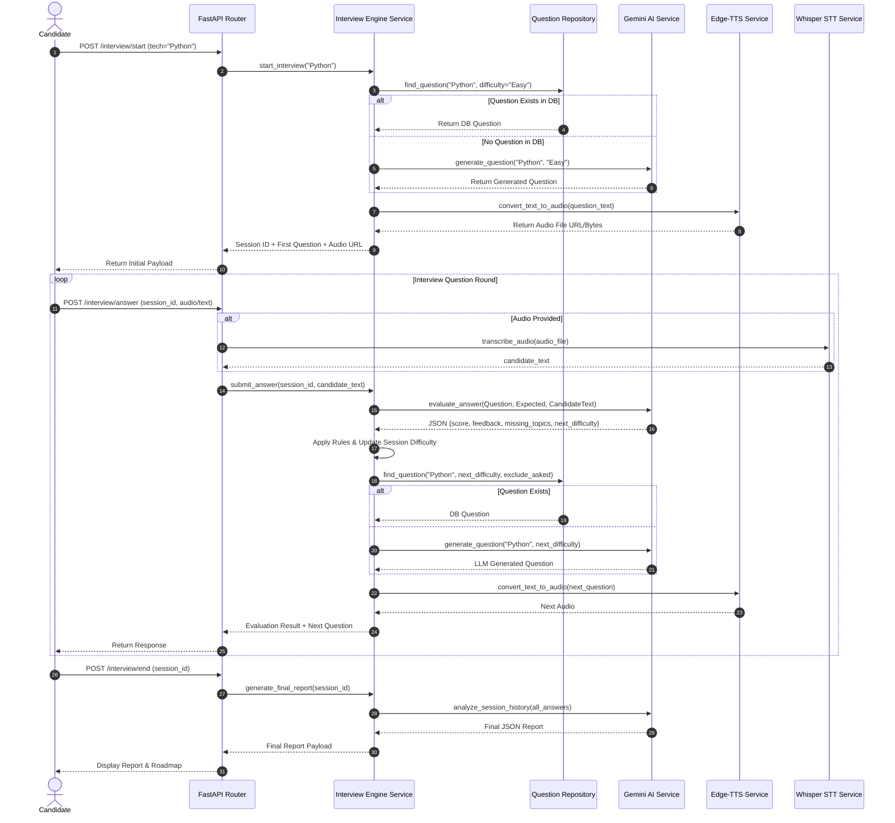
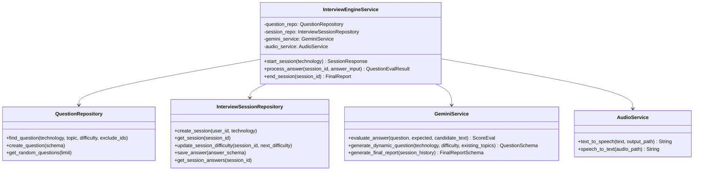

# Architecture & Implementation Plan - AI Interview Engine Backend

## System Overview & Architecture Rationale

The **AI Interview Readiness Platform** uses a **Deterministic Interview Engine** where the backend acts as the single source of truth for interview state management, difficulty transitions, and question routing. The LLM (Google Gemini) is strictly scoped to non-deterministic tasks: answer evaluation, dynamic question fallback generation, and final report compilation.

### Architecture Decisions (The "WHY")
1. **Backend-Driven State Engine (vs LLM Orchestrated)**:
   - *Why*: LLMs are non-deterministic, prone to hallucination, prompt injection, and state drift. Having the Python backend control the state machine ensures interview constraints (e.g., exactly N questions, deterministic difficulty escalation, strict topic coverage) are guaranteed.
2. **Clean Architecture (Routers -> Services -> Repositories -> Models)**:
   - *Why*: Decouples database models from business logic and HTTP interfaces. Routers remain thin controllers. Repositories abstract SQLAlchemy queries so database engines can be swapped or tested in isolation with mock sessions.
3. **Repository Pattern for Question Retrieval**:
   - *Why*: Standardizes complex querying logic (e.g., topic matching, difficulty filtering, excluding already asked questions in the session).
4. **Hybrid Question Selection (Database First, LLM Fallback)**:
   - *Why*: Maximizes speed, consistency, and lowers API cost by consuming pre-vetted domain questions from PostgreSQL. Recourses to Gemini only when database questions for a given topic/difficulty are exhausted.
5. **Asynchronous Audio Pipeline (Edge-TTS & Whisper)**:
   - *Why*: `edge-tts` provides high-quality neural voice synthesis without paid API keys. Whisper (via local `openai-whisper` / `faster-whisper`) provides robust offline/local Speech-To-Text transcription.

---

## User Review Required

> [!IMPORTANT]
> **Key Configuration Dependencies**:
> 1. **Gemini API Key**: Requires `GEMINI_API_KEY` set in `.env` (using Google GenAI SDK `google-genai` / `google-generativeai`).
> 2. **Audio Dependencies**: Speech-to-Text (Whisper) relies on PyTorch & ffmpeg; fallback text handling is built-in if audio dependencies are absent. Text-to-Speech uses `edge-tts`.
> 3. **Database URL**: Configured for Supabase PostgreSQL via `DATABASE_URL` with SQLAlchemy async or sync engine.

---

## Proposed System Design & File Layout

```
Backend_Prototype/
├── app/
│   ├── core/
│   │   ├── config.py           # Environment settings & Pydantic BaseSettings
│   │   ├── database.py         # SQLAlchemy Engine, SessionLocal, Base
│   │   └── security.py         # Utilities / Auth helpers
│   ├── models/
│   │   ├── __init__.py
│   │   ├── question.py         # Question & GeneratedQuestion DB models
│   │   └── session.py          # InterviewSession & InterviewAnswer DB models
│   ├── schemas/
│   │   ├── __init__.py
│   │   ├── question.py         # Question Pydantic v2 schemas
│   │   ├── interview.py        # Session, Answer, Eval & Final Report schemas
│   │   └── audio.py           # Audio request/response schemas
│   ├── repositories/
│   │   ├── __init__.py
│   │   ├── base.py             # Generic BaseRepository
│   │   ├── question_repo.py    # DB logic for curated & generated questions
│   │   └── session_repo.py     # DB logic for sessions & candidate answers
│   ├── services/
│   │   ├── __init__.py
│   │   ├── gemini_service.py   # Gemini integration (Eval, Gen, Final Report)
│   │   ├── audio_service.py    # STT (Whisper) & TTS (Edge-TTS) integration
│   │   ├── selection_service.py# Hybrid question selection logic
│   │   └── engine_service.py   # Interview Engine State Machine & Orchestration
│   ├── routers/
│   │   ├── __init__.py
│   │   ├── interview.py        # /interview/* endpoints
│   │   └── questions.py        # /questions/* endpoints
│   └── main.py                 # FastAPI App setup & CORS middleware
├── seed_data.py                # Pre-populated questions seed script
├── requirements.txt            # Python dependencies
└── README.md                   # Setup & usage instructions
```

---

## Technical Components & Schemas

### 1. Database Models (SQLAlchemy)

- **`Questions`**:
  - `id` (UUID / Integer Primary Key)
  - `technology` (String, e.g., 'Python', 'Java', 'DBMS')
  - `topic` (String, e.g., 'Decorators', 'AsyncIO')
  - `difficulty` (Enum/String: 'Easy', 'Medium', 'Hard')
  - `question` (Text)
  - `expected_answer` (Text)
  - `keywords` (JSON / ARRAY)
  - `llm_generated` (Boolean, default False)
  - `active` (Boolean, default True)

- **`GeneratedQuestions`**:
  - `id` (UUID / PK)
  - `session_id` (FK -> InterviewSession)
  - `technology`, `topic`, `difficulty`
  - `question_text`, `expected_answer`, `keywords`

- **`InterviewSessions`**:
  - `id` (UUID / PK)
  - `user_id` (String / UUID)
  - `technology` (String)
  - `current_difficulty` (String: 'Easy'|'Medium'|'Hard')
  - `status` (String: 'STARTED', 'IN_PROGRESS', 'COMPLETED')
  - `total_score` (Float)
  - `created_at`, `updated_at`

- **`InterviewAnswers`**:
  - `id` (UUID / PK)
  - `session_id` (FK -> InterviewSession)
  - `question_id` (FK -> Questions, nullable)
  - `generated_question_id` (FK -> GeneratedQuestions, nullable)
  - `question_text`, `expected_answer`
  - `candidate_transcript` (Text)
  - `candidate_audio_path` (String, nullable)
  - `score` (Float, 0-10)
  - `feedback` (Text)
  - `missing_topics` (JSON)
  - `next_difficulty` (String)

---

### 2. State Machine & Transition Rules

```
Candidate score evaluation rules:
- Score >= 8.0  => Upgrade Difficulty (Easy -> Medium -> Hard)
- Score >= 5.0  => Maintain Current Difficulty
- Score < 5.0   => Downgrade Difficulty (Hard -> Medium -> Easy)
```

---

## System Diagrams (Mermaid)

### Sequence Diagram: Candidate Interview Flow



### Class Diagram: Backend Clean Architecture



---

## Verification & Testing Plan

### Automated Tests
- Unit test database models and repositories using SQLite in-memory or PostgreSQL test db.
- Unit test Pydantic schemas validation.
- Unit test Gemini service schema parsing with mocked API calls.
- Unit test state engine difficulty rules (`>=8`, `>=5`, `<5`).

### Manual Verification
- Run FastAPI server locally using `uvicorn app.main:app --reload`.
- Perform sequential API calls:
  1. `POST /questions` (Seed initial Python/DBMS questions)
  2. `POST /interview/start` -> returns question + audio.
  3. `POST /interview/answer` -> returns score + next question.
  4. `POST /interview/end` -> returns complete final report & learning roadmap.
